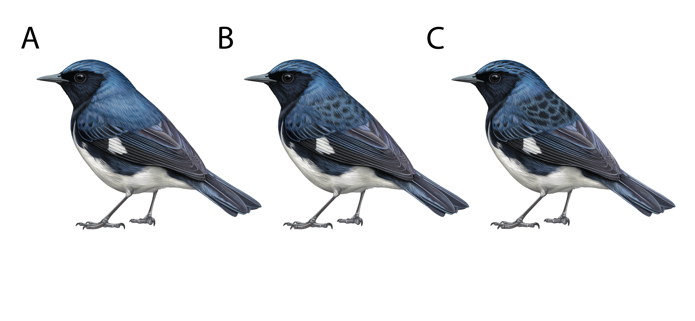

# Code for: Environment shapes plumage color variation in a new world warbler Setophaga caerulescens 
## Ore et al. 

-------------------------------------------------------------

### Overview: 
Within-species plumage variation allows us to investigate how the environment, 
feather structure, and genes together produce visible differences in appearance.
Color variation in male *Setophaga caerulescens* (Black-throated Blue Warbler) follows Gloger’s Rule—
a geographic pattern in which individuals tend to be darker in warmer and wetter environments.
Darker mantle coloration results from melanin granules deposited within the feather barbs,
shifting color of the barb from blue to black.
Color variation likely driven by the combined action of many genes—each contributing a small effect,
or to phenotypic plasticity, where individuals adjust their appearance in response to local environmental conditions. 
Plumage coloration in *S. caerulescens* is a window into the processes of adaptation,
revealing how genes, structure, and natural selection interact to shape wild populations over time.

Scripts in `R_scripts/` are numbered in the order they are run.

Folders: `data_raw/` holds inputs no script makes, `data/` the files the scripts make, `results/` tables and figures.
Each has one subfolder per topic: `specimens/`, `photos/`, `environment/`, `gwas/` (`data/gwas_inputs/` for the
GWAS phenotype files), `gene_lists/`, `pst_fst/`; in `results/` also `card_correction/`, `samples/`, `age/`,
`patch_correlations/`, `tables/` (formatted tables) and `figures/`.

### Data preparation

[00_card_correction/](R_scripts/00_card_correction/README.md): measures the colour card in every specimen photo and corrects each photo's plumage measurements for exposure and contrast (output: `data_raw/photos/card_corrected_mspec/`)

[01_data_cleaning.R](R_scripts/01_data_cleaning.R): specimen metadata, and the micaToolbox measurements averaged per bird and patch (`use_card_corrected` switch: card-corrected or uncorrected measurements)

[02_Environment_by_individual.R](R_scripts/02_Environment_by_individual.R): climate, elevation and NDVI for each specimen's collecting site

### Relationship between plumage and environment

[03_Age_color_models.Rmd](R_scripts/03_Age_color_models.md): looks for associations between age class and color

[04_Plumage_patch_correlations.Rmd](R_scripts/04_Plumage_patch_correlations.md): looks for correlations between different plumage patches

[05_Plumage_Env.Rmd](R_scripts/05_Plumage_Env.md): model selection and generalized additive models for associations between plumage color and environmental variables

[table_helpers.R](R_scripts/table_helpers.R): formatting of the results tables (sourced by 03–05)

[06_Pst_Fst.R](R_scripts/09_Pst_Fst.R): compares among-site differentiation in plumage luminance (Pst) with pairwise genomic Fst, and tests whether colour differences between sites follow geographic distance or Fst (Mantel tests)

### Relationship between plumage and genotype

[07a_GWAS_phenotype_inputs.R](R_scripts/06_GWAS_phenotype_inputs.R): phenotype, covariate and permutation files for the GWAS (all aged males; age-adjusted phenotypes for BSLMM)

[07b_GWAS.Rmd](R_scripts/07_GWAS.md): runs GEMMA BSLMM and ANGSD-asso

[08a_GWAS_BSLMM_SNPs.R](R_scripts/08a_GWAS_BSLMM_SNPs.R): GEMMA BSLMM: convergence of the three chains, hyperparameters (with a within-site permuted null), and SNPs with mean PIP >= 0.01

[08b_GWAS_ANGSD_asso_windows.R](R_scripts/08b_GWAS_ANGSD_asso_windows.R): ANGSD-asso in 50-SNP sliding windows: median LRT, null from the 200 within-age permutations (99.9th percentile) and the top 0.01% of windows; suggestive regions
    windows and permutation approach based on scripts found [here](https://github.com/lucasrocmoreira/Moreira-Smith_SciAdv_2023/tree/main)

[08c_GWAS_candidate_genes.R](R_scripts/08c_GWAS_candidate_genes.R): genes within 25 kb of the suggestive BSLMM SNPs and ANGSD window regions, compared with known melanogenesis genes

[08d_GWAS_manhattan_plots.R](R_scripts/08d_GWAS_manhattan_plots.R): Manhattan plots (ANGSD window medians, BSLMM PIP) with the suggestive hits and their genes labelled

