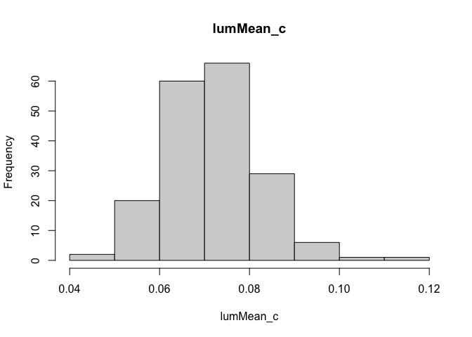
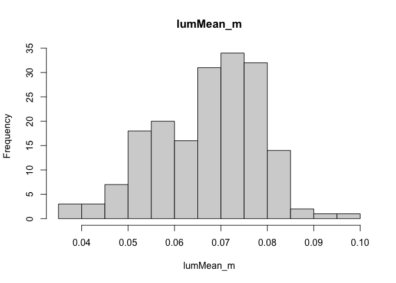
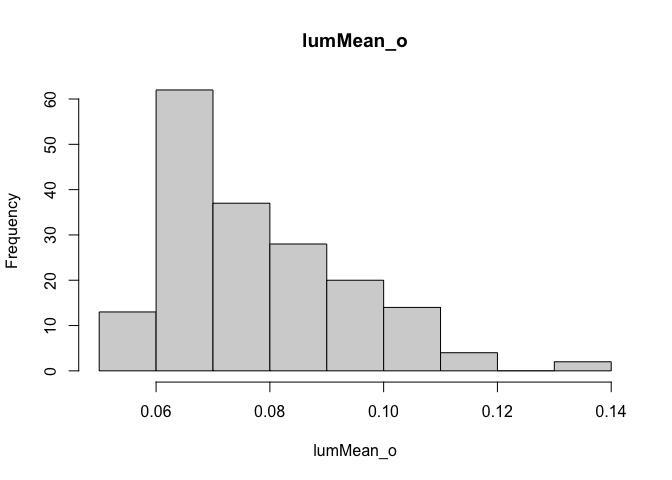
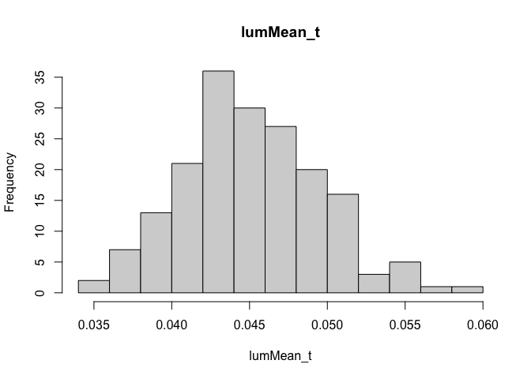
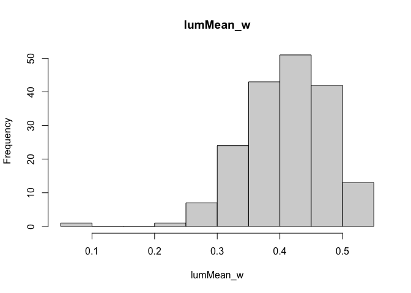
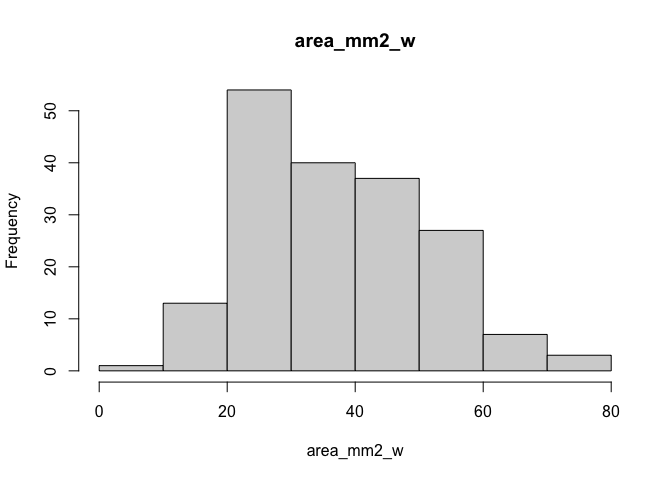

Are dark-backed birds darker overall?
================
Ore, MJ.
2025-03-10

# normality checks

<!-- --><!-- --><!-- --><!-- --><!-- --><!-- -->

# make a table of results

| Explanatory | Response | n (SY) | Estimate (SE) | p | Age estimate (SE) | Age p | R²m |
|:---|:---|:---|:---|:---|:---|:---|:---|
| Mantle luminance | Crown luminance | 182 (70) | 0.25 (0.087) | 0.0053 | -0.0030 (0.0016) | 0.072 | 0.058 |
|  | Throat luminance | 181 (70) | 0.14 (0.033) | \< 0.001 | 0.0014 (6.5e-04) | 0.030 | 0.20 |
|  | Covert luminance | 179 (69) | 0.38 (0.11) | \< 0.001 | 0.015 (0.0022) | \< 0.001 | 0.35 |
|  | Wing spot luminance | 181 (69) | -0.35 (0.40) | 0.39 | -0.090 (0.0085) | \< 0.001 | 0.44 |
|  | Wing spot area (mm²) | 181 (69) | -106 (83) | 0.21 | -15 (1.9) | \< 0.001 | 0.31 |
| Wing spot luminance | Crown luminance | 182 (70) | -0.0089 (0.015) | 0.54 | -0.0022 (0.0021) | 0.29 | 0.0056 |
|  | Covert luminance | 180 (70) | 0.037 (0.019) | 0.055 | 0.021 (0.0027) | \< 0.001 | 0.30 |
|  | Throat luminance | 181 (70) | -0.0050 (0.0060) | 0.40 | 0.0018 (8.5e-04) | 0.033 | 0.065 |
|  | Wing spot area (mm²) | 182 (70) | 62 (16) | \< 0.001 | -10 (2.3) | \< 0.001 | 0.36 |
| Wing spot area (mm²) | Crown luminance | 182 (70) | -1.9e-05 (6.4e-05) | 0.77 | -0.0016 (0.0019) | 0.38 | 0.0041 |
|  | Covert luminance | 180 (70) | -2.9e-05 (8.6e-05) | 0.73 | 0.017 (0.0025) | \< 0.001 | 0.28 |
|  | Throat luminance | 181 (70) | 1.7e-05 (2.6e-05) | 0.53 | 0.0026 (7.6e-04) | \< 0.001 | 0.064 |

Associations between plumage patches

Linear mixed models: response ~ explanatory + Age + (1 \| collection
year). Age estimate = SY minus ASY. R²m = marginal R² (explanatory and
Age together). Luminance = mean double-cone catch of the patch.
