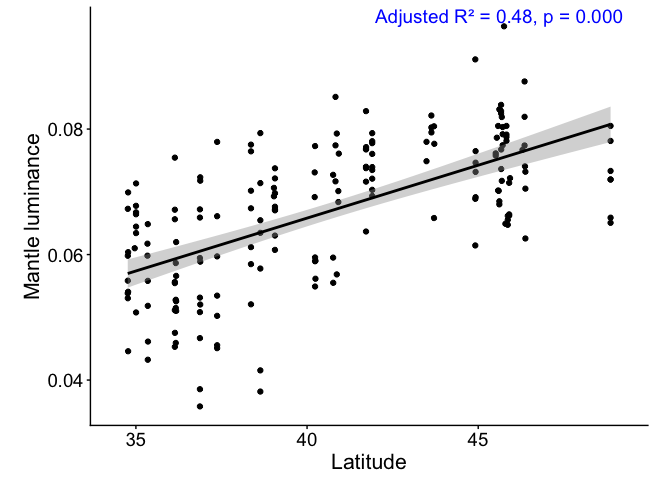
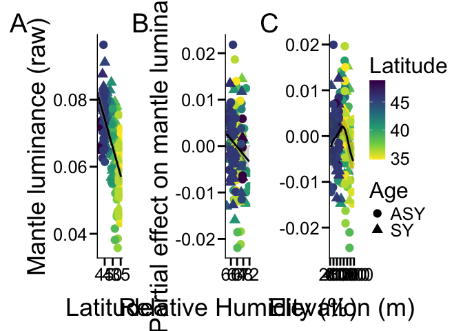

Plumage_environment
================
Ore, MJ.
2025-03-11

    ## here() starts at /Users/madelynore/Documents/Work/PhD/BTBW_geographic_coloration/BTBW_plumage

## Does location predict color ?

    ## 
    ## Call:
    ## lm(formula = lumMean_m ~ lat + Age, data = lum_env, na.action = na.omit)
    ## 
    ## Residuals:
    ##        Min         1Q     Median         3Q        Max 
    ## -0.0228129 -0.0047847 -0.0000424  0.0056682  0.0242061 
    ## 
    ## Coefficients:
    ##              Estimate Std. Error t value Pr(>|t|)    
    ## (Intercept) 0.0002703  0.0058997   0.046    0.964    
    ## lat         0.0015714  0.0001453  10.816  < 2e-16 ***
    ## AgeSY       0.0071890  0.0012569   5.719 4.41e-08 ***
    ## ---
    ## Signif. codes:  0 '***' 0.001 '**' 0.01 '*' 0.05 '.' 0.1 ' ' 1
    ## 
    ## Residual standard error: 0.008171 on 179 degrees of freedom
    ##   (3 observations deleted due to missingness)
    ## Multiple R-squared:  0.487,  Adjusted R-squared:  0.4812 
    ## F-statistic: 84.95 on 2 and 179 DF,  p-value: < 2.2e-16

    ## Warning in geom_point(width = 0.6, position = position_dodge(width = 0.7)):
    ## Ignoring unknown parameters: `width`

    ## `geom_smooth()` using formula = 'y ~ x'

    ## Warning: `position_dodge()` requires non-overlapping x intervals.

<!-- -->

    ## Warning: In lm.fit(x, y, offset = offset, singular.ok = singular.ok, ...) :
    ##  extra argument 'REML' will be disregarded

    ##                                                       formulas    df     AICc
    ## mod2d                            lumMean_m ~ s(lon, lat) + Age  8.64 -1242.35
    ## mod2dL                                lumMean_m ~ s(lat) + Age  7.83 -1241.41
    ## mod2dbyY              lumMean_m ~ s(lon, lat, by = Year) + Age 27.20 -1237.77
    ## modlmY                                  lumMean_m ~ Year + Age  9.00 -1237.57
    ## mod2dY                    lumMean_m ~ s(lon, lat) + Year + Age 13.16 -1234.57
    ## mod2dYY        lumMean_m ~ s(lon, lat, by = Year) + Year + Age 30.30 -1232.80
    ## modlmlat_randY              lumMean_m ~ lat + (1 | Year) + Age  5.00 -1193.62
    ## modnull                                    lumMean_m ~ 1 + Age  3.00 -1138.66
    ##                deltaic weights MarginalR2 ConditionalR2
    ## mod2d             0.00 5.4e-01         NA            NA
    ## mod2dL            0.94 3.4e-01         NA            NA
    ## mod2dbyY          4.57 5.5e-02         NA            NA
    ## modlmY            4.78 5.0e-02         NA            NA
    ## mod2dY            7.78 1.1e-02         NA            NA
    ## mod2dYY           9.54 4.6e-03         NA            NA
    ## modlmlat_randY   48.72 1.4e-11       0.46          0.51
    ## modnull         103.69 1.7e-23         NA            NA

## GAMs

``` r
gam_rhs  <- "s(lon, lat) + s(RH_br) + s(Tave_br) + s(PPT_br) + s(srtm) + s(ndvi_M) + Age"
response <- "lumMean"  # column prefix: "lumMean" -> lumMean_c, lumMean_m, ...; "PC1" -> PC1_c, ...

gam_fits <- list()          
gam_results <- list()
# models: luminance of each patch, plus wing spot size (area, mm2)
gam_models <- c(setNames(paste0(response, "_", names(patches)), names(patches)), wsize = "area_mm2_w")
gam_labels <- c(patches, wsize = "wspot size")
for (p in names(gam_models)) {
  patch_name <- gam_labels[[p]]
  column     <- gam_models[[p]]            # e.g. "lumMean_c", "area_mm2_w"

  if (!column %in% names(lum_env)) stop("Column not found in lum_env: ", column)

  dat <- lum_env %>%
    filter(!is.na(.data[[column]]))

  fit <- gam(as.formula(paste(column, "~", gam_rhs)), select = TRUE, data = dat, method = "REML")
  gam_fits[[p]] <- fit      # saved by patch code (gam_fits$m = mantle model), used for the plots
  sm  <- summary(fit)

  # smooth terms
  smooths <- as.data.frame(sm$s.table) %>%
    rownames_to_column("term") %>%
    transmute(term, edf, F, p = `p-value`)

  # Age is a parametric term: reported in the same table (F = t^2 for a 1-df term)
  age_row <- tibble(term = "Age (SY vs ASY)", edf = 1,
                    F = sm$p.table["AgeSY", "t value"]^2,
                    p = sm$p.table["AgeSY", "Pr(>|t|)"])

  gam_results[[column]] <- bind_rows(smooths, age_row) %>%
    mutate(response = column, patch = patch_name, n = nrow(dat),
           dev_expl = sm$dev.expl, .before = 1)
}

gam_results <- bind_rows(gam_results)
```

``` r
# GAM results: tidy CSV (numbers as numbers, one row per term) + readable table with one
# block of rows per patch (n and deviance explained in the block header)
source(here("R_scripts/table_helpers.R"))
write.csv(gam_results, here("results/Env_GAM_pl_patches.csv"), row.names = FALSE)

gam_table <- gam_results %>%
  mutate(Model = sprintf("%s (n = %d, deviance explained %.0f%%)", patch_label(response), n, 100 * dev_expl)) %>%
  transmute(Model, Term = term_label(term), edf = sprintf("%.2f", edf), F = sprintf("%.2f", F), p = fmt_p(p))
gam_note <- paste("GAMs (mgcv, REML, select = TRUE so unneeded smooths shrink towards zero):",
                  "response ~", gam_rhs, ". Age is parametric (edf = 1, F = t²).")

print(knitr::kable(blank_repeats(gam_table, "Model"), caption = "Plumage and environment (GAMs)"))
```

| Model | Term | edf | F | p |
|:---|:---|:---|:---|:---|
| Covert luminance (n = 180, deviance explained 43%) | Location (longitude × latitude) | 4.60 | 0.55 | 0.0010 |
|  | Relative humidity, breeding season | 2.78 | 1.17 | 0.0033 |
|  | Mean temperature, breeding season | 0.14 | 0.02 | 0.24 |
|  | Precipitation, breeding season | 0.00 | 0.00 | 0.46 |
|  | Elevation | 0.00 | 0.00 | 0.31 |
|  | NDVI (maximum) | 0.00 | 0.00 | 0.58 |
|  | Age (SY vs ASY) | 1.00 | 78.54 | \< 0.001 |
| Crown luminance (n = 185, deviance explained 30%) | Location (longitude × latitude) | 6.63 | 1.21 | \< 0.001 |
|  | Relative humidity, breeding season | 0.84 | 0.22 | 0.034 |
|  | Mean temperature, breeding season | 0.00 | 0.00 | 0.24 |
|  | Precipitation, breeding season | 2.11 | 1.35 | \< 0.001 |
|  | Elevation | 0.96 | 2.39 | \< 0.001 |
|  | NDVI (maximum) | 1.46 | 0.53 | 0.018 |
|  | Age (SY vs ASY) | 1.00 | 0.83 | 0.36 |
| Mantle luminance (n = 182, deviance explained 60%) | Location (longitude × latitude) | 3.21 | 1.68 | \< 0.001 |
|  | Relative humidity, breeding season | 0.79 | 0.41 | 0.018 |
|  | Mean temperature, breeding season | 0.00 | 0.00 | 0.33 |
|  | Precipitation, breeding season | 1.78 | 0.90 | 0.0040 |
|  | Elevation | 2.33 | 1.24 | \< 0.001 |
|  | NDVI (maximum) | 0.00 | 0.00 | 0.61 |
|  | Age (SY vs ASY) | 1.00 | 31.08 | \< 0.001 |
| Throat luminance (n = 182, deviance explained 26%) | Location (longitude × latitude) | 1.77 | 0.81 | \< 0.001 |
|  | Relative humidity, breeding season | 0.20 | 0.03 | 0.26 |
|  | Mean temperature, breeding season | 0.30 | 0.05 | 0.20 |
|  | Precipitation, breeding season | 0.00 | 0.00 | 0.54 |
|  | Elevation | 0.00 | 0.00 | 0.88 |
|  | NDVI (maximum) | 1.64 | 0.63 | 0.022 |
|  | Age (SY vs ASY) | 1.00 | 16.59 | \< 0.001 |
| Wing spot luminance (n = 182, deviance explained 47%) | Location (longitude × latitude) | 0.63 | 0.03 | 0.24 |
|  | Relative humidity, breeding season | 0.00 | 0.00 | 0.33 |
|  | Mean temperature, breeding season | 1.49 | 0.44 | 0.049 |
|  | Precipitation, breeding season | 0.81 | 0.48 | 0.017 |
|  | Elevation | 0.00 | 0.00 | 0.71 |
|  | NDVI (maximum) | 0.50 | 0.10 | 0.15 |
|  | Age (SY vs ASY) | 1.00 | 140.99 | \< 0.001 |
| Wing spot area (mm²) (n = 182, deviance explained 31%) | Location (longitude × latitude) | 0.00 | 0.00 | 0.86 |
|  | Relative humidity, breeding season | 0.00 | 0.00 | 0.55 |
|  | Mean temperature, breeding season | 0.00 | 0.00 | 0.43 |
|  | Precipitation, breeding season | 0.00 | 0.00 | 0.55 |
|  | Elevation | 0.00 | 0.00 | 0.62 |
|  | NDVI (maximum) | 0.00 | 0.00 | 0.85 |
|  | Age (SY vs ASY) | 1.00 | 80.02 | \< 0.001 |

Plumage and environment (GAMs)

``` r
cat("\n", gam_note, "\n")
```

GAMs (mgcv, REML, select = TRUE so unneeded smooths shrink towards
zero): response ~ s(lon, lat) + s(RH_br) + s(Tave_br) + s(PPT_br) +
s(srtm) + s(ndvi_M) + Age . Age is parametric (edf = 1, F = t²).

``` r
save_table(
  gam_table %>%
    gt(groupname_col = "Model") %>%
    tab_header(title = "Plumage and environment (GAMs)") %>%
    tab_source_note(gam_note) %>%
    style_table(),
  "Env_GAM_pl_patches")
```

``` r
# Partial-effect plots -------------------------------------------------------
# For each patch GAM, one panel per environmental variable showing that variable's
# fitted smooth on its own, s(variable), i.e. its partial effect:
#   - line + band: the smooth and its 95% confidence interval. The y-axis is the
#     change in the response due to this term; mgcv centres each smooth so its
#     average over the birds is 0 (so it's a difference from average, not a
#     predicted luminance, and no "average bird" has to be made up).
#   - points: partial residuals = each bird's model residual + its value of this
#     term, i.e. the data with the effects of all OTHER terms (location, other
#     climate variables, age) removed.
# A term the model shrank away (select = TRUE) shows as a flat line at 0.
# The first panel is the RAW latitude relationship (latitude sits inside the 2-D
# s(lon, lat) surface, so it has no one-dimensional partial effect).

# Environmental variables to plot, with axis labels (a named vector: column = label)
env_vars <- c(PPT_br = "Mean Precipitation (mm)",
              RH_br = "Relative Humidity (%)",
              srtm    = "Elevation (m)")

response_label <- c(lumMean = "luminance", PC1 = "PC1")[[response]]

# Which patches to plot (codes from `patches`): "m" = mantle only.
# For all five use names(patches)
plot_patches <- "m"

for (p in plot_patches) {
  column  <- paste0(response, "_", p)                  # e.g. "lumMean_m"
  y_label <- paste(tools::toTitleCase(patches[[p]]), response_label)
  model   <- gam_fits[[p]]

  # the exact rows the model was fitted on (so residuals line up with birds)
  birds <- model$model

  panels <- list()

  # Latitude: raw data with a linear fit (descriptive, not a model effect)
  panels[["lat"]] <- ggplot(birds, aes(x = lat, y = .data[[column]])) +
    geom_point(aes(color = lat, shape = Age), size = 4) +
    geom_smooth(method = "lm", color = "black") +
    scale_x_reverse() +
    scale_color_viridis_c(direction = -1) +
    labs(x = "Latitude", y = paste(y_label, "(raw)"), color = "Latitude")

  for (v in names(env_vars)) {
    term <- paste0("s(", v, ")")                        # e.g. "s(srtm)"

    # The smooth over the observed range of v. predict() needs every model
    # variable in newdata, but with type = "terms" only this term is returned,
    # so the other columns (copied from the first bird) don't affect the result.
    grid <- birds[rep(1, 100), ]
    grid[[v]] <- seq(min(birds[[v]]), max(birds[[v]]), length.out = 100)
    curve <- predict(model, newdata = grid, type = "terms", terms = term, se.fit = TRUE)
    grid$effect   <- curve$fit[, term]
    grid$lower_CI <- curve$fit[, term] - 1.96 * curve$se.fit[, term]
    grid$upper_CI <- curve$fit[, term] + 1.96 * curve$se.fit[, term]

    if (anyNA(grid$effect)) stop("Partial effect is NA for ", column, " vs ", v)

    # Partial residuals: residual + this bird's value of the term
    # (Gaussian model, so the default deviance residuals = observed - fitted)
    bird_terms <- predict(model, type = "terms", terms = term)
    birds$partial_residual <- residuals(model) + bird_terms[, term]

    # edf and p-value of this smooth, shown above the panel
    term_stats <- summary(model)$s.table[term, ]
    # mgcv reports p-values below ~2e-16 as exactly 0
    p_text <- ifelse(term_stats[["p-value"]] < 2e-16, "p < 2e-16",
                     paste("p =", signif(term_stats[["p-value"]], 2)))
    subtitle <- paste0("edf = ", round(term_stats[["edf"]], 2), ", ", p_text)

    panels[[v]] <- ggplot(birds, aes(x = .data[[v]], y = partial_residual)) +
      geom_hline(yintercept = 0, linetype = "dashed", color = "grey50") +
      geom_point(aes(color = lat, shape = Age), size = 4) +
      geom_ribbon(data = grid, aes(x = .data[[v]], ymin = lower_CI, ymax = upper_CI),
                  alpha = 0.2, inherit.aes = FALSE) +
      geom_line(data = grid, aes(x = .data[[v]], y = effect),
                linewidth = 1, color = "black", inherit.aes = FALSE) +
      scale_color_viridis_c(direction = -1) +
      labs(x = env_vars[[v]], y = paste("Partial effect on", tolower(y_label)),
           subtitle = subtitle, color = "Latitude")
  }

  env_plots <- wrap_plots(panels, nrow = 1) +
    plot_annotation(tag_levels = "A") +
    plot_layout(axis_titles = "collect", guides = "collect") &   # one shared legend
    theme_classic() &
    theme(text = element_text(size = 24))

  print(env_plots)
  ggsave(here(paste0("results/env_plots_", column, ".png")), plot = env_plots,
         width = 8 * length(panels), height = 8, dpi = 600)
}
```

    ## `geom_smooth()` using formula = 'y ~ x'
    ## `geom_smooth()` using formula = 'y ~ x'

<!-- -->
